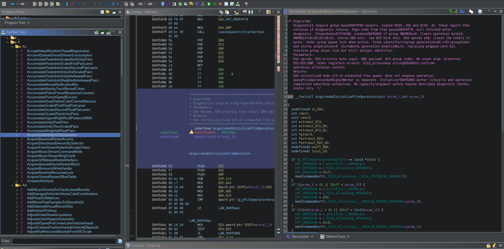

# NFS III Reversed Engineered

Reverse engineering and decompilation of **Need for Speed III: Hot Pursuit** using Ghidra. All **4,040 internal functions are named**, including the final 24 complex routines reviewed in the latest analysis pass. The Ghidra project includes comments, types, and references. Complex follow-up investigations are documented separately; this project provides an annotated Ghidra database rather than a buildable game reconstruction.

The target is based on [VEG's Modern Patch v1.6.1](https://veg.by/en/projects/nfs3/), with small copyright and version-text changes in `nfs3.exe` and the setup menu preparing our local **1.6.2** version. The two modified files are included under [`nfs3_decomp.rep/Electronic Arts/Need For Speed III/`](nfs3_decomp.rep/Electronic%20Arts/Need%20For%20Speed%20III/):

- `nfs3.exe`: local v1.6.2 version/About text and VEG & Melroy attribution.
- `FEDATA/MENUS/setup.mnu`: updated `Visit veg.by (v1.6.2)` menu text.

See [target provenance](docs/TARGET.md) for details and file fingerprints.



*The annotated Ghidra project includes descriptive function names, comments, types, and references. 100% of the 4,040 internal functions have names.*

## Bug reports and game improvements

The reverse-engineered code and annotated Ghidra project give us a foundation for investigating bugs, implementing fixes, and adapting the game. You can now [open an issue](https://github.com/melroy89/nfs3-re/issues) to report a problem or propose an improvement, such as multiplayer changes, expanded race options, or adjustments to pursuit and traffic behavior.

For bugs, include your game/patch version, operating system or Wine version, reproduction steps, and expected versus actual behavior. For feature requests, describe how you want the game to behave and why the change would help. Each proposal still needs investigation and in-game validation; see [CONTRIBUTING.md](CONTRIBUTING.md) for details.

## Install Ghidra

1. Download the latest stable release from [Ghidra releases](https://github.com/NationalSecurityAgency/ghidra/releases). Under **Assets**, choose the **`.zip` with `PUBLIC` in its name**, such as `ghidra_<version>_PUBLIC_<date>.zip`. Avoid the **Source code** archives.
2. Install the **64-bit JDK** required by that release, as documented in its bundled `GettingStarted.html`. Our current environment uses **Ghidra 12.1.4 and JDK 21**. The JDK includes the Java runtime; a standalone JRE is insufficient.
3. Extract Ghidra into a new directory and launch `./ghidraRun` on Linux/macOS or `ghidraRun.bat` on Windows.

On Debian, Ubuntu, Linux Mint, and derivatives where the default JDK provides Java 21:

```sh
sudo apt update
sudo apt install default-jdk
```

Check with `java -version` and `javac -version`. Older distribution releases may default to an older JDK. If needed, install [Temurin 21](https://adoptium.net/temurin/releases/?version=21) separately. If Ghidra asks for a Java location, select the JDK directory containing `bin/`.

## Clone and open

```sh
git clone https://github.com/melroy89/nfs3-re.git
cd nfs3-re
```

The checkout includes the complete Ghidra project layout:

```text
nfs3-re/
├── README.md
├── nfs3_decomp.gpr
└── nfs3_decomp.rep/
    ├── project.prp
    ├── idata/
    └── versioned/
```

The `.gpr` file is an empty project marker; the analysis is stored in the matching `.rep` directory. Keep them together.

1. In Ghidra, choose **File → Open Project** and select **`nfs3-re/nfs3_decomp.gpr`**.
2. Expand **Electronic Arts → Need For Speed III** and double-click **nfs3.exe**.
3. Select a function under **Symbol Tree → Functions** to inspect its assembly and pseudocode. Use **Window → Decompiler** if the pane is hidden, or press **G** to navigate to an address.

Only the two modified files listed above are tracked from the standalone game directory; all other game files remain excluded. These standalone files are **not needed to browse the saved analysis**: the similarly named folder inside Ghidra is part of the database. A separate game installation and its remaining assets are required to play.

Save regularly. Save and close Ghidra before committing database changes, making backups, or upgrading. See [release preparation](docs/RELEASE.md) for validation status.

## How we approached the decompilation

We combined reverse-engineering tools, AI-assisted analysis, and hands-on testing:

- [Ghidra](https://github.com/NationalSecurityAgency/ghidra) provided disassembly, decompiled pseudocode, cross-references, and the saved analysis database.
- [Ghidra MCP](https://github.com/bethington/ghidra-mcp) connected the AI assistants to the live project for inspecting functions and saving names, types, labels, and comments.
- [REA MCP](https://github.com/morluto/rea) supported binary inspection and additional reverse-engineering investigations.
- **GPT 6.1 Sol**, assisted by **three Luna 6 sub-agents**, handled the main analysis and parallel investigations of smaller functions. Findings were reviewed before being incorporated into the project.
- **GPT 6 Astra** investigated the more complex code, including numerical routines, physics, rendering, and unresolved calling conventions.

Names and explanations were grounded in assembly, callers, constants, and data flow. Selected numerical routines were checked by executing extracted original instructions in isolated test harnesses. For questions requiring live behavior, Melroy played specific scenarios under **Wine** while runtime memory was inspected and compared with the static analysis.

The resulting names are descriptive analyst assignments; the pseudocode is a reconstruction of the compiled program. Evidence and remaining uncertainties are recorded in Ghidra and the [detailed analysis notes](analysis/detailed-analysis-notes.md). Analysis annotations are saved in the project without modifying the executable; the separate version/menu edits are described above.

## Contributing and license

See [contribution guidance](CONTRIBUTING.md), [sharing analysis](docs/SHARING.md), and [release preparation](docs/RELEASE.md).

Original contributions are licensed under **Apache-2.0**; see [LICENSE](LICENSE) and [NOTICE](NOTICE). This does not relicense the game, VEG's patch, or imported third-party bytes in the databases. Review redistribution rights before publication.

Credit to Electronic Arts, VEG, and the Ghidra authors. This independent project claims no affiliation or endorsement.
